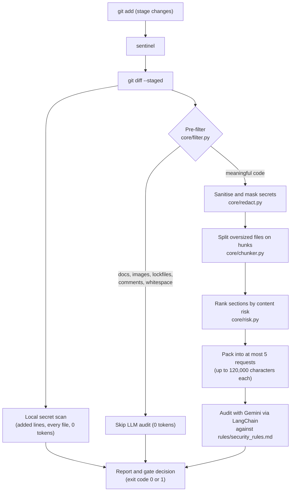

# Sentinel-Code

**A token-efficient AI security and architecture auditor for Git diffs.**

Sentinel-Code reviews your staged changes before they are committed. It discards non-functional noise locally for free, masks secrets on your machine before anything is sent over the network, and audits the meaningful code changes against your own security rules using Google Gemini. Large diffs are never silently truncated, and an incomplete audit never reports a pass.

[](https://www.python.org/)
[](https://www.langchain.com/)
[](https://ai.google.dev/)
[](RELEASE_NOTES_v0.1.1.md)
[](#testing)
[](LICENSE)

---

## Contents

- [Key features](#key-features)
- [How it works](#how-it-works)
- [Quick start](#quick-start)
- [Usage](#usage)
- [Git hook and gating](#git-hook-and-gating)
- [Security rules](#security-rules)
- [Security and privacy model](#security-and-privacy-model)
- [Known limitations](#known-limitations)
- [Testing](#testing)
- [Benchmarks](#benchmarks)
- [Project structure](#project-structure)
- [Roadmap](#roadmap)
- [License](#license)

---

## Key features

| | Feature | What it does |
| :-: | :--- | :--- |
| ⚡ | **Zero-token pre-filter** | Skips documentation, images, lockfiles, comment-only edits and whitespace-only reformatting locally, with no API call. |
| 🛡️ | **Local privacy shield** | Detects and masks credentials on your machine before any network call. Reports show only the first few characters of a secret, followed by asterisks. |
| 🎯 | **Diff-aware secret handling** | Only lines a commit **adds** are findings. Removing a leaked credential is never blocked, because it is the fix. |
| 🧠 | **Content-based risk scoring** | When a diff is too large to audit in full, sections are prioritised by what the added code does (command execution, SQL string building, TLS bypass, and so on), never by file name. |
| 🧩 | **Hunk-aware chunking** | Oversized files are split on hunk boundaries instead of truncated, so every changed line can be audited. |
| 🚦 | **Strict completeness** | If any part of a diff cannot be audited within the request budget, the report names it, never says "Audit Passed", and the gate fails by default. |
| 🔒 | **Prompt-injection defences** | Diffs are wrapped in `<code_diff>` data tags, closing tags and markdown fences are neutralised, and the model is told to treat the diff purely as data. |
| 📋 | **Customisable policy** | 28 built-in rules in plain Markdown. Any repository can supply its own `rules/security_rules.md`. |
| 🧾 | **Structured output** | Typed Pydantic findings, rendered as Markdown, JSON or SARIF v2.1.0. |
| 🌍 | **Global CLI** | One `sentinel` command, on Windows, macOS and Linux, audits any Git repository on your machine. |

---

## How it works



| Stage | Module | Behaviour |
| :--- | :--- | :--- |
| 1. Local secret scan | `core/redact.py` | Scans the **added lines of every file**, including docs and skipped files, for credentials. No LLM call. |
| 2. Pre-filter | `core/filter.py` | Decides per file whether a change is worth an LLM call. Config files (`.env`, `.yaml`, `.json`, `.toml`) are never skipped, and a comment that looks like it contains a secret is kept. |
| 3. Mask | `core/redact.py` | Replaces secrets with `[REDACTED:<type>]` on added lines and `[REDACTED-NOT-ADDED:<type>]` on removed or unchanged lines, so the model can tell a credential being introduced from one being deleted. |
| 4. Split | `core/chunker.py` | Files larger than one request (120,000 characters, about 30,000 tokens) are split on hunk boundaries. A single oversized hunk is split by line with corrected `@@` line numbers. Each part repeats the file header. |
| 5. Rank and pack | `core/risk.py`, `core/chunker.py` | Sections are ranked by security-relevant content on added lines, then packed first-fit into at most 5 requests. Anything that does not fit is reported as skipped, never dropped silently. |
| 6. Audit | `core/auditor_agent.py` | Up to 3 requests run concurrently. Gemini returns typed `Finding` objects checked against your rules. |
| 7. Gate | `interfaces/cli.py` | Applies `--fail-on` and `--fail-on-incomplete` and sets the exit code. |

### Example output

A commit that adds a Google API key to a documentation file is caught locally, with no LLM call. The key is masked in the report:

```text
🚨 **[Local Secret Detection]**: Hardcoded credentials or tokens detected locally (0 LLM tokens used):
- **File:** `NOTES.md` | **Type:** `google_api_key` | **Pattern:** `AIza********`

*Fix: Remove these credentials from your commit and move them to environment variables.*

⚡ *[LLM Audit Skipped]*: Remaining changes are documentation, formatting, or comments. 0 tokens used.

❌ [Audit Failed]: Gatekeeper policy triggered: Hardcoded secrets detected by local privacy scanner.
```

Findings from the LLM audit use this layout (risk level, file, violation, affected line, suggested fix; the content below is illustrative):

```text
- **Risk Level**: [HIGH]
- **File Path**: `routes/users.py`
- **Violation Summary**: SQL Injection Prevention: query built from user input with an f-string
- **Affected Line / Code**: `query = f"SELECT * FROM profiles WHERE id = '{user_id}'"`
- **Suggested Fix**: Use a parameterised query: cursor.execute("SELECT * FROM profiles WHERE id = %s", (user_id,))
```

---

## Quick start

**Requirements:** Python 3.11 or newer, Git, and a [Gemini API key](https://aistudio.google.com/apikey).

### 1. Clone and configure

```bash
git clone https://github.com/SHREYASHSINGHAI/Sentinel-Code.git
cd Sentinel-Code

# macOS / Linux
cp .env.example .env
# Windows (cmd)
copy .env.example .env
```

Edit `.env`:

```env
GEMINI_API_KEY=your_gemini_api_key_here
MODEL="gemini-2.5-flash"
```

`GOOGLE_API_KEY` is also accepted. Keep `.env` out of version control (it is already in `.gitignore`).

### 2. Install

<details open>
<summary><strong>macOS / Linux</strong></summary>

```bash
python3 -m venv .venv
source .venv/bin/activate
pip install -r requirements.txt

# Make `sentinel` available from any project
chmod +x scripts/sentinel
echo 'export PATH="$PATH:'"$(pwd)"'/scripts"' >> ~/.zshrc   # or ~/.bashrc
source ~/.zshrc
```

</details>

<details>
<summary><strong>Windows</strong></summary>

```powershell
python -m venv .venv
.\.venv\Scripts\activate
pip install -r requirements.txt
```

Then add the absolute path of the `scripts` folder (for example `D:\Sentinel-Code\scripts`) to your user `Path`:
**Start → "Environment Variables" → User variables → Path → Edit → New**, and restart your terminal.

</details>

The launchers use Sentinel's own `.venv` automatically, check that dependencies and an API key are present, and run the CLI against whichever Git repository you are standing in.

### 3. Run it

```bash
cd /path/to/your-project
git add .
sentinel
```

---

## Usage

```text
sentinel [--format {markdown,json,sarif}]
         [--fail-on {high,medium,low,any,none}]
         [--fail-on-incomplete | --no-fail-on-incomplete]
         [--model MODEL]
```

| Flag | Values | Default | Description |
| :--- | :--- | :---: | :--- |
| `--format` | `markdown`, `json`, `sarif` | `markdown` | Output format. |
| `--fail-on` | `high`, `medium`, `low`, `any`, `none` | `high` | Exit with code `1` if a finding at or above this level is present. `none` is report-only mode. |
| `--fail-on-incomplete` / `--no-fail-on-incomplete` | flag | **on** (off with `--fail-on none`) | Exit with code `1` if part of the diff could not be audited within the request limit. Use `--no-fail-on-incomplete` to allow partial audits. |
| `--model` | string | `$MODEL`, else `gemini-2.5-flash` | Gemini model to use. |

### Exit codes

| Code | Meaning |
| :-: | :--- |
| `0` | Gate passed: no staged changes, nothing to audit, or no finding at or above the threshold. |
| `1` | Gate failed: a secret was added, a finding met the threshold, the audit was incomplete, or Git failed. |

A hardcoded secret that a commit **adds** fails the gate at any `--fail-on` level except `none`. Secrets that a commit removes, or that sit in unchanged context lines, never do.

### Output formats

```bash
sentinel                  # human-readable Markdown report
sentinel --format json    # list of findings
sentinel --format sarif   # SARIF v2.1.0
```

> **Note:** `json` and `sarif` contain the LLM findings. Local secret detections and "audit skipped" notices are reported in the Markdown output and through the exit code. See [Known limitations](#known-limitations).

---

## Git hook and gating

Sentinel-Code exits non-zero when the gate fails, so it can block a commit.

### Option A: `pre-commit` framework

Add to your project's `.pre-commit-config.yaml`:

```yaml
repos:
  - repo: local
    hooks:
      - id: sentinel-code
        name: Sentinel-Code Security Audit
        entry: sentinel --fail-on high
        language: system
        stages: [pre-commit]
        always_run: true
        pass_filenames: false
```

### Option B: native Git hook (no extra dependencies)

```bash
cp scripts/pre-commit-hook.sh /path/to/your-project/.git/hooks/pre-commit
chmod +x /path/to/your-project/.git/hooks/pre-commit
```

[`scripts/pre-commit-hook.sh`](scripts/pre-commit-hook.sh) runs `sentinel --fail-on high` and blocks the commit on failure. To bypass it intentionally, use `git commit --no-verify`.

---

## Security rules

Policy lives in plain Markdown in [`rules/security_rules.md`](rules/security_rules.md). It is injected into the audit prompt, so you can read, review and edit exactly what the auditor is told to enforce.

| Area | Rules covered |
| :--- | :--- |
| **Secrets and configuration** | Hardcoded credentials, secrets in config files, sensitive data in logs |
| **Injection** | SQL, command, NoSQL and LDAP injection, XSS, XXE |
| **Access and sessions** | Authentication and rate limiting, broken access control (IDOR), JWT handling, cookies and sessions |
| **Cryptography** | Weak password hashing, weak ciphers, insecure randomness, disabled TLS verification |
| **Dangerous operations** | `eval` / `exec` / `os.system`, insecure deserialisation, path traversal, SSRF, open redirects |
| **Web and API hygiene** | Permissive CORS, insecure file uploads, input validation, debug mode, error handling, ReDoS |
| **Supply chain** | Vulnerable or unpinned dependencies |

### Per-repository rules

If the repository you are auditing contains its own `rules/security_rules.md` in the directory where you run `sentinel`, those rules are used **instead of** Sentinel's built-in set. Otherwise Sentinel falls back to its own. To keep the defaults and add to them, copy the built-in file into your project and extend it.

---

## Security and privacy model

**What stays on your machine**

- Git diff extraction, the pre-filter, secret scanning, masking, splitting, risk scoring and the gate decision.
- Reports never print a full secret: previews show at most the first four characters (and never more than a quarter of the value) followed by a fixed run of asterisks, so the length is not revealed either.

**What is sent to Gemini**

- The file paths, the rules text, and the diffs of files that passed the pre-filter, after secret masking. Documentation, images and lockfiles are not sent.

**What gets masked** (best effort)

Google API keys, AWS access keys, GitHub tokens, Slack tokens, Stripe keys, `sk-…` API keys, JWTs, PEM private keys, passwords inside connection URLs, quoted assignments such as `api_key = "…"`, and unquoted `.env` style assignments such as `DB_PASSWORD=…`. Secrets on removed and unchanged lines are masked too, so nothing leaves the machine unmasked.

**Audit integrity**

- A request budget of 5 prevents runaway API usage. Sections that do not fit are listed in the report as not checked.
- Findings come from a language model and are probabilistic. Treat Sentinel-Code as an additional safety net alongside code review and dedicated scanners such as Gitleaks or Semgrep, not as a replacement.

---

## Known limitations

- **Git diff formatting.** Sentinel reads `git diff --staged` as Git formats it. Settings that change diff output, such as `color.ui=always`, can make staged changes unreadable to the parser and cause them to be skipped. Keep `color.ui` at `auto` (the default).
- **Python version.** Use Python 3.11 or newer. The launchers set `PYTHONSAFEPATH`, which prevents a project's own `core/` folder from shadowing Sentinel's modules; that option does not exist on Python 3.10.
- **API failures.** If a Gemini request fails (rate limit, timeout, network), the whole audit aborts with an error and exits non-zero. There is no automatic retry yet.
- **JSON and SARIF coverage.** These formats contain LLM findings only and carry no line numbers. Local secret detections and "audit skipped" notices appear in Markdown output and the exit code.
- **Staged changes only.** Sentinel audits `git diff --staged`; it does not scan existing history or unstaged files.
- **Network and provider.** An audit of code changes requires network access to Google's Gemini API.

---

## Testing

```bash
pip install -r requirements.txt
pytest
```

The suite contains **82 tests** that run without an API key or network access (the LLM is replaced by a stub).

| Suite | Covers | Tests |
| :--- | :--- | :-: |
| `tests/test_filter.py` | Pre-filter: file skipping, comment and whitespace handling, diff parsing | 26 |
| `tests/test_redact.py` | Secret masking and local detection | 7 |
| `tests/test_secret_scanning.py` | Diff-aware scanning, masked previews, removal handling | 15 |
| `tests/test_diff_lines_and_risk.py` | Line classification and content-based risk scoring | 10 |
| `tests/test_chunker.py` | Hunk splitting, line renumbering, budget planning | 12 |
| `tests/test_gate_and_pipeline.py` | Gate policy, completeness guarantees, end-to-end pipeline | 12 |

Additional scripts (not part of `pytest`):

```bash
# End-to-end audit of a sample diff with deliberate test credentials (calls Gemini)
python -m tests.test_brain

# Replay recent commits of any repository through the pre-filter (free, 0 tokens)
python tests/filter_benchmark_test.py --repo . --n 50

# Security benchmark: local analysis only (0 tokens), or live with Gemini
python tests/gold_standard_benchmark.py --offline
python tests/gold_standard_benchmark.py
```

---

## Benchmarks

Full logs are in [`docs/assets/`](docs/assets/).

**Pre-filter.** Replaying the last 50 commits of this repository, the filter skipped **21 (42%)** without any LLM call, at a median of **0.18 ms** per diff ([details](docs/assets/filter_test_result.md)).

**Credential detection (local, 0 tokens).** On the credential cases of the gold-standard set, the local scanner caught all 5 real credential cases and flagged 2 of 3 deliberately safe cases (a mock test key and a placeholder), a trade-off in favour of not missing secrets ([details](docs/assets/gold_standard_benchmark_results.md)).

The committed gold-standard report is an **offline** run: it evaluates the local layer only. Semantic rules (SQL injection, XSS, SSRF and so on) are judged by the LLM and are exercised only by the live run (`python tests/gold_standard_benchmark.py`), so the committed overall precision and recall figures should not be read as a measure of the LLM audit.

---

## Project structure

```text
.
├── core/
│   ├── auditor_agent.py      # Audit pipeline: sanitise, mask, plan, call Gemini, build report
│   ├── chunker.py            # Hunk-aware splitting and budgeted request planning
│   ├── diff_lines.py         # Line classification (added / removed / context) and hunk parsing
│   ├── filter.py             # Language-aware pre-filter (docs, comments, whitespace, lockfiles)
│   ├── redact.py             # Secret detection, masking and masked previews
│   ├── risk.py               # Content-based risk scoring for prioritisation
│   └── rules_loader.py       # Rule discovery with per-repository override
├── interfaces/
│   └── cli.py                # Command-line interface and gate logic
├── rules/
│   └── security_rules.md     # The 28 security and architecture rules
├── scripts/
│   ├── sentinel              # Launcher for macOS / Linux
│   ├── sentinel.bat          # Launcher for Windows
│   └── pre-commit-hook.sh    # Native Git pre-commit hook
├── tests/                    # Unit, integration and benchmark scripts
├── docs/assets/              # Benchmark and test result logs
├── .pre-commit-config.yaml   # pre-commit framework hook definition
├── .env.example              # Configuration template
├── requirements.txt          # Dependencies
├── RELEASE_NOTES_v0.1.1.md   # What changed in v0.1.1
└── LICENSE                   # MIT
```

---

## Roadmap

| Phase | Milestone | Status |
| :-: | :--- | :-: |
| **1** | Local CLI auditor, zero-token pre-filter, privacy redaction, gating | ✅ Complete |
| **2** | GitHub Action / pull-request review bot with inline comments | 🚧 In progress |
| **3** | Dashboard for organisation-wide security tracking | 📋 Planned |

---

## License

Released under the [MIT License](LICENSE).
