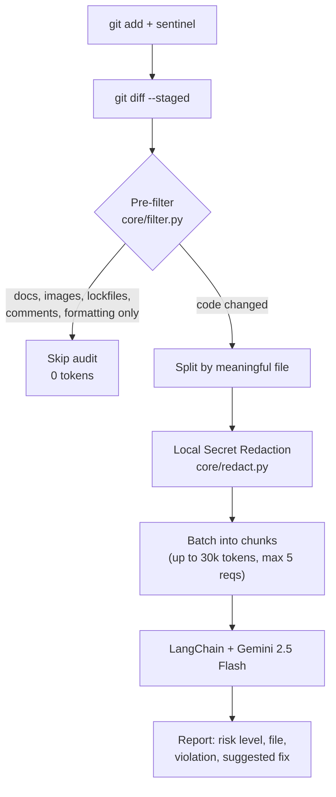

# Sentinel-Code

**A token-efficient AI security auditor for Git diffs.** Sentinel-Code filters out trivial changes locally, then sends only meaningful code changes to an LLM to check against your own security rules.


-orange)


<!-- TODO: add a 20-40s demo GIF here, e.g. docs/assets/demo.gif -->


---

## Why this exists

My first version sent full files to the LLM on every commit. Token usage grew fast, commits got slow, and the model commented on whitespace and documentation changes.

The fix was to stop sending code that doesn't need review. Sentinel-Code decides locally, for free, whether a diff contains a real code change, and only then calls the model.

## How it works



**1. Local pre-filter (no API call).** The diff is split per file. A file is skipped when:
- it is non-code: `.md`, `.txt`, `.rst`, images, lockfiles
- only blank lines or comments changed (language-aware; comments that mention secrets such as `api_key` or `password` are still audited)
- only formatting changed (re-indentation or spacing)

Config files (`.yaml`, `.json`, `.toml`, `.env`) are deliberately **not** skipped, because secrets often leak there.

**2. Local privacy shield (secret masking).** Before any diff leaves your machine, `core/redact.py` scans for credentials (Google, AWS, GitHub, Stripe, private keys, database passwords, and quoted secrets) and replaces them with placeholders (e.g. `[REDACTED:google_api_key]`). The model can still audit and flag the hardcoded credential violation without ever seeing your actual secret.

**3. Per-file chunking & token budget.** Meaningful files are batched into chunks of up to 30,000 tokens (~120,000 characters) each, sending up to a maximum of 5 requests per audit. If changes exceed 5 requests, remaining files are skipped with a clear warning, and Sentinel refuses to grant a blanket "Audit Passed" status.

**4. Rule-based audit.** The diff is checked against `rules/security_rules.md` (or your repo's local rules). Safeguards: the diff is wrapped in `<code_diff>` tags, fences and backticks are sanitized to prevent prompt injection, and the model is instructed to treat diff content purely as passive data.

## Results

The filter was replayed over real commit history using `tests/filter_benchmark_test.py`. Token counts are **estimates** (characters ÷ 4) and the baseline is "send every diff to the LLM".

| Repo | Commits | Skipped (0 API calls) | Est. token reduction |
|---|---|---|---|
| This repo | 29 | 16 (55%) | 48% |
| [pallets/click](https://github.com/pallets/click) (last 50 commits) | 50 | 6 (12%) | 15% |

These numbers describe filtering efficiency, not answer quality. Savings depend on the repo. A repo with many documentation and config-only commits benefits most, while a code-heavy repo benefits less. Median filter time is under 1 ms per commit. Full output for this repo: [docs/assets/filter_test_result.md](docs/assets/filter_test_result.md).

## Quick start

### 1. Clone & install Sentinel-Code

```bash
git clone https://github.com/SHREYASHSINGHAI/Sentinel-Code.git
cd Sentinel-Code
```

Create a `.env` file from the template and add your Gemini API key ([get one here](https://aistudio.google.com/apikey)):

```env
GEMINI_API_KEY=your_api_key_here
MODEL="gemini-2.5-flash"
```

---

### 2. Setup Guide

#### Option A: Windows Setup

1. **Create virtual environment and install dependencies:**
   ```powershell
   python -m venv .venv
   .\.venv\Scripts\activate
   pip install -r requirements.txt
   copy .env.example .env
   ```

2. **Add `sentinel` to your system `PATH` (Run from ANY project):**
   - Press the **Windows Key**, type **Environment Variables**, and select **Edit the system environment variables**.
   - Click the **Environment Variables...** button.
   - Under **User variables**, select **`Path`** and click **Edit...**.
   - Click **New** and paste the full path to your Sentinel-Code `scripts` directory (e.g., `C:\path\to\Sentinel-Code\scripts` or `D:\Sentinel-Code\scripts`).
   - Click **OK** to save and restart your terminal.

3. **Audit any project on your machine:**
   Navigate to any git repository on your computer and run:
   ```cmd
   cd C:\path\to\your-project
   git add .
   sentinel
   ```

---

#### Option B: macOS / Linux Setup

1. **Create virtual environment and install dependencies:**
   ```bash
   python3 -m venv .venv
   source .venv/bin/activate
   pip install -r requirements.txt
   cp .env.example .env
   ```

2. **Make launcher executable and add to `PATH` (Run from ANY project):**
   ```bash
   chmod +x scripts/sentinel
   
   # Add to ~/.zshrc (or ~/.bashrc if using bash):
   echo 'export PATH="$PATH:'"$(pwd)"'/scripts"' >> ~/.zshrc
   source ~/.zshrc
   ```

3. **Audit any project on your machine:**
   Navigate to any git repository on your computer and run:
   ```bash
   cd /path/to/your-project
   git add .
   sentinel
   ```

---

### Try the bundled example

Runs the auditor on a sample diff that contains a hardcoded fake key and database password:

```bash
python -m tests.test_brain
```

## Customizing the rules

Edit `rules/security_rules.md`. The current rules cover hardcoded credentials, SQL injection, missing auth or rate limiting, leaking error traces, and dangerous system calls (`eval`, `exec`, `os.system`). Add your own as plain markdown.

If a project has its own `rules/security_rules.md`, Sentinel uses that project's rules; otherwise, it falls back to Sentinel's default guidelines.

## Running the tests and benchmark

```bash
# unit tests for pre-filter and secret masking (no API key needed)
python -m pytest tests/test_filter.py tests/test_redact.py

# end-to-end check of the auditor on a diff with fake secrets (calls Gemini, needs API key)
python -m tests.test_brain

# replay the last 50 commits of any local git repo through the filter (free, no API key)
python tests/filter_benchmark_test.py --repo . --n 50
```

The benchmark measures the **filter** (skip rate, estimated tokens, speed). It never calls the LLM, so it says nothing about the quality of the audit reports.

## Project structure

```
.
├── core/
│   ├── auditor_agent.py      # CodeAuditorBrain: prompt, safeguards, LLM call
│   ├── filter.py             # per-file diff filtering
│   ├── redact.py             # local pre-audit secret masking
│   └── rules_loader.py       # loads rules/security_rules.md (with fallback)
├── interfaces/
│   └── cli.py                # audits `git diff --staged`
├── rules/
│   └── security_rules.md     # your security and architecture rules
├── scripts/
│   ├── sentinel              # cross-project launcher for macOS/Linux
│   └── sentinel.bat          # cross-project launcher for Windows
├── tests/
│   ├── test_filter.py        # unit tests for the filter
│   ├── test_redact.py        # unit tests for secret redaction
│   ├── test_brain.py         # end-to-end auditor check (needs API key)
│   └── filter_benchmark_test.py  # filter skip rate and token estimates
├── docs/assets/              # screenshots and benchmark output
├── requirements.txt
├── .env.example
└── LICENSE
```

## Roadmap

| Phase | Scope | Status |
|---|---|---|
| 1 | Local CLI auditor and diff pre-filter | Done |
| 2 | GitHub PR webhook that posts review comments | Planned |
| 3 | Streamlit dashboard for multi-repo compliance tracking | Planned |

## Known limitations

- **Advisory by design.** Sentinel-Code prints a report for your staged changes. It never blocks a commit or push, and you run it yourself after `git add`.
- **Heuristic filtering, not an AST parser.** It works on diff lines. Python docstrings are treated as code, and files skipped by type (`.md`, `.txt`) are never audited, so a secret placed there would be missed.
- **Token budget & request cap.** Sentinel-Code batches files into chunks of up to 120,000 characters (~30,000 tokens) and sends at most 5 requests per audit to protect API budgets. If a staged diff exceeds 5 chunks, remaining files are intentionally omitted, an alert lists the unchecked files, and Sentinel refuses to grant an "Audit Passed" rating.
- **Model output is free-form markdown.** LLMs can miss issues or flag false positives. Use Sentinel-Code as a review aid alongside tools like gitleaks or CodeQL, not as a replacement.
- **Code is sent to a third party.** Audited diffs are sent to Google's Gemini API. Do not use it on code you are not allowed to share with that service.

## Contributing

Issues and pull requests are welcome. Good starting points: more filter edge cases, extra rule sets (for example OWASP-based), and tests.

## License

MIT. See [LICENSE](LICENSE).
