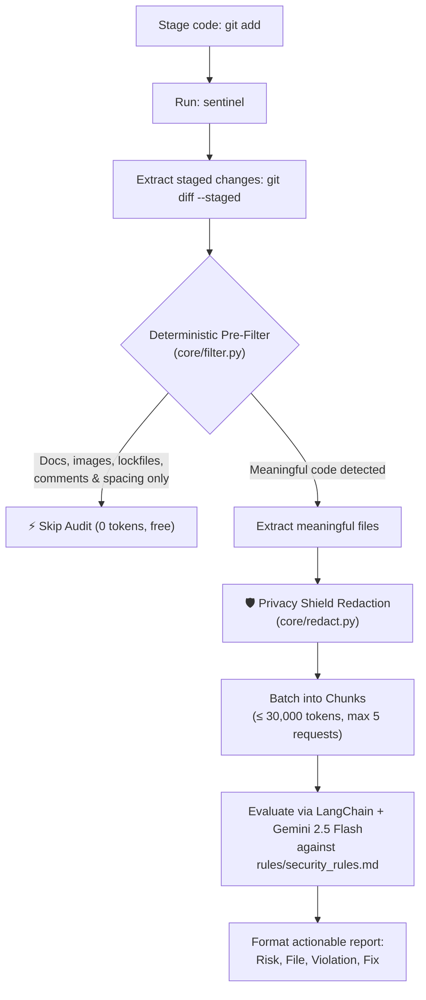

# Sentinel-Code

**A Token-Efficient AI Security & Architecture Auditor for Git Diffs.**

Sentinel-Code intercepts staged Git diffs locally, filters out non-functional noise for free (zero LLM tokens), masks sensitive secrets on-device for privacy, and audits meaningful code changes against customizable security guidelines using Google Gemini.

[](https://www.python.org/)
[](https://www.langchain.com/)
[](https://ai.google.dev/)
[-orange.svg)]()
[](LICENSE)

---


---

## Key Features

- **⚡ Zero-Token Local Pre-Filtering**: Deterministically discards documentation, image assets, lockfiles, comment-only edits, and whitespace reformatting locally without consuming API quotas.
- **🛡️ Local Privacy Shield (Secret Redaction)**: Identifies credentials (Google, AWS, GitHub, Stripe, Slack, private keys, database connection strings, and generic assignments) and masks them on your machine before network transmission.
- **📦 Smart Multi-File Chunking**: Batches meaningful files into manageable contexts up to 30,000 tokens (~120,000 characters) per request, with a safety cap of 5 requests per audit.
- **🛡️ Partial-Audit Protection**: If changes are truncated or exceed budget limits, Sentinel-Code explicitly warns which files were skipped and strictly refuses to issue a false "Audit Passed" status.
- **🔒 Prompt-Injection Defenses**: Wraps incoming diffs in strict `<code_diff>` data tags, neutralizes markdown fences (`'''`), and sanitizes closing tags to prevent malicious instruction overrides.
- **📋 Customizable Policy Engine**: Define enterprise or team-specific guidelines in plain Markdown (`rules/security_rules.md`). Supports per-repository custom rules with automatic fallback.
- **🌍 Universal Cross-Platform CLI**: Standalone native launchers (`sentinel.bat` for Windows and `sentinel` for macOS/Linux) let you audit *any* Git repository on your machine with a single command.

---

## Architecture & Workflow



---

## Benchmark & Token Reduction

Benchmark tests replayed over real commit histories demonstrate significant token and latency savings:

| Repository | Commits Evaluated | Commits Skipped (0 Tokens) | Estimated Token Reduction | Median Filter Latency |
| :--- | :---: | :---: | :---: | :---: |
| **Sentinel-Code** | 29 | 16 (55%) | **48%** | < 1 ms |
| **[pallets/click](https://github.com/pallets/click)** | 50 | 6 (12%) | **15%** | < 1 ms |

*Detailed benchmark logs are available in [docs/assets/filter_test_result.md](docs/assets/filter_test_result.md).*

---

## Installation & Setup

### 1. Clone & Prepare Environment

```bash
git clone https://github.com/SHREYASHSINGHAI/Sentinel-Code.git
cd Sentinel-Code
```

Create your `.env` configuration from the provided template:

```bash
# Windows
copy .env.example .env

# macOS / Linux
cp .env.example .env
```

Add your Gemini API key to `.env` ([Get an API key here](https://aistudio.google.com/apikey)):

```env
GEMINI_API_KEY=your_gemini_api_key_here
MODEL="gemini-2.5-flash"
```

---

### 2. Platform Setup Guides

#### Option A: Windows Setup (Recommended)

1. **Create and activate virtual environment:**
   ```powershell
   python -m venv .venv
   .\.venv\Scripts\activate
   pip install -r requirements.txt
   ```

2. **Add `sentinel` to your System `PATH` (Run from any project):**
   - Press <kbd>Win</kbd> and search for **Environment Variables**.
   - Under **User variables**, select **`Path`** and click **Edit**.
   - Click **New** and add the absolute path to your Sentinel-Code `scripts` directory (e.g., `D:\Sentinel-Code\scripts`).
   - Click **OK** to save and restart your terminal.

3. **Audit any project:**
   Navigate to any Git project on your machine and run:
   ```cmd
   cd C:\path\to\your-project
   git add .
   sentinel
   ```

---

#### Option B: macOS / Linux Setup

1. **Create and activate virtual environment:**
   ```bash
   python3 -m venv .venv
   source .venv/bin/activate
   pip install -r requirements.txt
   ```

2. **Configure executable launcher and System `PATH`:**
   ```bash
   chmod +x scripts/sentinel
   
   # Add to ~/.zshrc (or ~/.bashrc for Bash users):
   echo 'export PATH="$PATH:'"$(pwd)"'/scripts"' >> ~/.zshrc
   source ~/.zshrc
   ```

3. **Audit any project:**
   Navigate to any Git project on your machine and run:
   ```bash
   cd /path/to/your-project
   git add .
   sentinel
   ```

---

## Customizing Security & Architecture Rules

Audit guidelines are configured in standard Markdown inside `rules/security_rules.md`:

```markdown
# Security & Architecture Guidelines

1. **No Hardcoded Credentials:** Never hardcode API keys, passwords, or secrets.
2. **SQL Injection Prevention:** All SQL queries must use parameterized inputs or ORMs.
3. **Rate Limiting & Auth:** Public routes must include authentication or rate limiting.
4. **Error Handling:** Avoid printing raw exception traces or sensitive debug information.
5. **No Dangerous System Calls:** Prohibit eval(), exec(), and unformatted subprocess/system calls.
```

> **Hierarchy Support:** If a target repository defines its own `rules/security_rules.md`, Sentinel-Code applies those local rules. Otherwise, it automatically falls back to Sentinel's global guidelines.

---

## Testing & Quality Assurance

Run the test suite across filter logic and redaction engines:

```bash
# Run unit tests for filter and secret masking
pytest tests/test_filter.py tests/test_redact.py

# End-to-end audit check on sample diff containing deliberate test credentials
python -m tests.test_brain

# Benchmark commit history across any repository (free, 0 tokens)
python tests/filter_benchmark_test.py --repo . --n 50
```

---

## Project Structure

```text
.
├── core/
│   ├── auditor_agent.py      # Core brain: LangChain chain, safeguards, prompt orchestration
│   ├── filter.py             # Language-aware AST/diff pre-filtering engine
│   ├── redact.py             # Local regex-based secret and credential masking
│   └── rules_loader.py       # Rule discovery with local project fallback
├── interfaces/
│   └── cli.py                # Command-line interface for staged Git diffs
├── rules/
│   └── security_rules.md     # Security, architecture, and quality rules
├── scripts/
│   ├── sentinel              # Cross-platform launcher for macOS / Linux
│   └── sentinel.bat          # Native batch launcher for Windows
├── tests/
│   ├── test_filter.py        # Pre-filter unit tests
│   ├── test_redact.py        # Secret masking and redaction unit tests
│   ├── test_brain.py         # End-to-end integration test
│   └── filter_benchmark_test.py # Replay benchmark over Git histories
├── docs/assets/              # Visuals, benchmarks, and test results
├── requirements.txt          # Production dependencies
├── .env.example              # Environment configuration template
└── LICENSE                   # MIT License
```

---

## Roadmap

| Phase | Milestone | Status |
| :---: | :--- | :---: |
| **Phase 1** | Local CLI auditor, zero-token pre-filter, and privacy redaction | ✅ Complete |
| **Phase 2** | GitHub Action / PR review webhook with inline comment bot | 🚧 In Progress |
| **Phase 3** | Enterprise dashboard for organization-wide security tracking | 📋 Planned |

---

## License

This project is licensed under the MIT License. See [LICENSE](LICENSE) for details.
