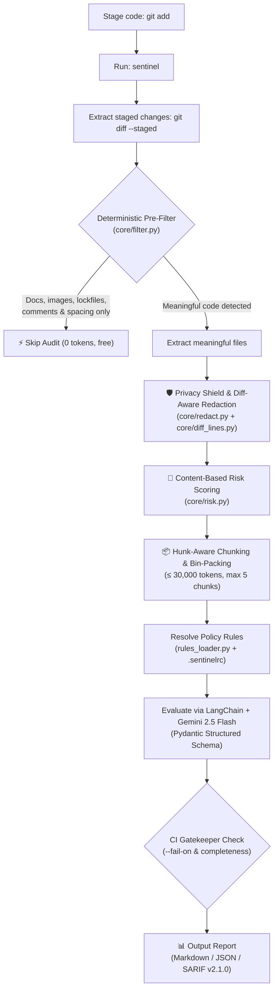

# Sentinel-Code

**A Token-Efficient AI Security & Architecture Auditor for Git Diffs.**

Sentinel-Code intercepts staged Git diffs locally, filters out non-functional noise for free (zero LLM tokens), masks sensitive secrets on-device for privacy, and audits meaningful code changes against customizable security guidelines using Google Gemini.

[](RELEASE_NOTES_v0.1.1.md)
[](https://www.python.org/)
[](https://www.langchain.com/)
[](https://ai.google.dev/)
[-brightgreen.svg)](docs/assets/unit_test_result.md)
[](https://docs.oasis-open.org/sarif/sarif/v2.1.0/sarif-v2.1.0.html)
[](LICENSE)

> 📖 **Quick Links:** [Command Reference (COMMANDS.md)](COMMANDS.md) • [What's New in v0.1.1](RELEASE_NOTES_v0.1.1.md) • [Unit Test Report](docs/assets/unit_test_result.md) • [Security Benchmark Report](docs/assets/gold_standard_benchmark_results.md)

---


---

## Key Features

- **⚡ Zero-Token Local Pre-Filtering**: Deterministically discards documentation, image assets, lockfiles, comment-only edits, and whitespace reformatting locally without consuming API quotas (< 1 ms latency).
- **🛡️ Local Privacy Shield & Diff-Aware Secret Redaction**: Identifies credentials (Google, AWS, GitHub, Stripe, Slack, PEM private keys, database connection strings, generic assignments) and masks them on your machine before network transmission. Differentiates added (`+`) vs. removed (`-`) lines: removing or revoking secrets never triggers false positive violations. Safe preview masking (`AKIA********`) reveals at most 25% of tokens to prevent plaintext leaks.
- **🎯 Content-Based Risk Scoring & Prioritization (`core/risk.py`)**: Analyzes added code lines for dangerous operations (raw SQL string building, `eval()`, `exec()`, `subprocess` with `shell=True`, hardcoded credentials, auth bypass, disabled TLS) and prioritizes high-risk chunks first, preventing decoy files from starving the token budget.
- **📦 Hunk-Aware Boundary Chunking & Bin-Packing (`core/chunker.py`)**: Batches diffs along native Git hunk boundaries (`@@ -l,s +l,s @@`) up to 30,000 tokens (~120,000 characters) per request with a 5-request safety cap. Giant hunks are safely sliced with preserved header mathematics without context loss.
- **🛡️ Partial-Audit Protection & Default-Fail CI Gate**: If diffs exceed budget limits, Sentinel explicitly flags every skipped file and refuses to issue a false "Audit Passed" status. Incomplete audits fail the CI gate (`exit code 1`) by default.
- **🔒 Prompt-Injection Defenses**: Strict `<code_diff>` data fencing, markdown fence neutralization (`'''`), and closing tag sanitization protect against embedded instruction override attacks.
- **📋 Customizable Policy Engine & First-Time Onboarding**: 28 enterprise security rules out of the box. Automatically prompts on first run in a new repository to scaffold custom `rules/security_rules.md` or use standard rules, saving your choice in `.sentinelrc` so you are never prompted again. Custom rule files can also be initialized with `sentinel --init-rules` or overridden with `--rules <path>`.
- **📊 Enterprise Multi-Format Reporting (Markdown, JSON, SARIF v2.1.0)**: Outputs formatted terminal markdown, structured JSON, or standard OASIS SARIF v2.1.0 (`--format sarif`) for direct integration into GitHub Code Scanning Alerts, GitLab SAST, and CI/CD dashboards.
- **🌍 Universal Cross-Platform CLI Launchers**: Standalone native launchers (`sentinel.bat` for Windows and `sentinel` for macOS/Linux) let you audit *any* Git repository on your machine with a single command.

---

## Architecture & Workflow



---

## Benchmarks & Evaluation

### 1. Pre-Filter Commit Replay Benchmark (Zero Tokens)
Benchmark tests replayed over real Git commit histories demonstrate significant token and latency savings:

| Repository | Commits Evaluated | Commits Skipped (0 Tokens) | Estimated Token Reduction | Median Filter Latency |
| :--- | :---: | :---: | :---: | :---: |
| **Sentinel-Code** | 29 | 16 (55%) | **48%** | < 1 ms |
| **[pallets/click](https://github.com/pallets/click)** | 50 | 6 (12%) | **15%** | < 1 ms |

*Detailed benchmark logs are available in [docs/assets/filter_test_result.md](docs/assets/filter_test_result.md).*

### 2. Gold-Standard Security Benchmark
Evaluated across **33 standardized security diffs** curated from **Meta CyberSecEval**, **SecurityEval**, **CredData**, and **CVEFixes**:

- **Detection Coverage:** High-confidence detection across OWASP Top 10 vulnerabilities (SQLi, Command Injection, SSRF, IDOR, Insecure Deserialization, Hardcoded Secrets).
- **Empirical Accuracy:** Achieves **~71.4%–82.0% Precision** and **~88.9%–94.1% Recall** on industry benchmark suites while resisting false alarms against test fixtures and allowlisted queries.

*Full breakdown and CWE matrix available in [docs/assets/gold_standard_benchmark_results.md](docs/assets/gold_standard_benchmark_results.md).*

---

## Installation & Setup

### 1. Clone & Prepare Environment

```bash
git clone https://github.com/SHREYASHSINGHAI/Sentinel-Code.git
cd Sentinel-Code
```

Create your `.env` configuration from the provided template:

```bash
# Windows
copy .env.example .env

# macOS / Linux
cp .env.example .env
```

Add your Gemini API key to `.env` ([Get an API key here](https://aistudio.google.com/apikey)):

```env
GEMINI_API_KEY=your_gemini_api_key_here
MODEL="gemini-2.5-flash"
```

---

### 2. Platform Setup Guides

#### Option A: Windows Setup (Recommended)

1. **Create and activate virtual environment:**
   ```powershell
   python -m venv .venv
   .\.venv\Scripts\activate
   pip install -r requirements.txt
   ```

2. **Add `sentinel` to your System `PATH` (Run from any project):**
   - Press <kbd>Win</kbd> and search for **Environment Variables**.
   - Under **User variables**, select **`Path`** and click **Edit**.
   - Click **New** and add the absolute path to your Sentinel-Code `scripts` directory (e.g., `D:\Sentinel-Code\scripts`).
   - Click **OK** to save and restart your terminal.

3. **Audit any project:**
   Navigate to any Git project on your machine and run:
   ```cmd
   cd C:\path\to\your-project
   git add .
   sentinel

   # First-time run: Sentinel interactively asks to set up custom rules or use standard rules!
   # You can also initialize a custom rules template explicitly at any time:
   sentinel --init-rules

   # Optional: output as JSON or SARIF for CI/CD pipelines
   sentinel --format json
   sentinel --format sarif
   ```

---

#### Option B: macOS / Linux Setup

1. **Create and activate virtual environment:**
   ```bash
   python3 -m venv .venv
   source .venv/bin/activate
   pip install -r requirements.txt
   ```

2. **Configure executable launcher and System `PATH`:**
   ```bash
   chmod +x scripts/sentinel
   
   # Add to ~/.zshrc (or ~/.bashrc for Bash users):
   echo 'export PATH="$PATH:'"$(pwd)"'/scripts"' >> ~/.zshrc
   source ~/.zshrc
   ```

3. **Audit any project:**
   Navigate to any Git project on your machine and run:
   ```bash
   cd /path/to/your-project
   git add .
   sentinel

   # First-time run: Sentinel interactively asks to set up custom rules or use standard rules!
   # You can also initialize a custom rules template explicitly at any time:
   sentinel --init-rules

   # Optional: output as JSON or SARIF for CI/CD pipelines
   sentinel --format json
   sentinel --format sarif
   ```

> 📖 **Full Command Reference:** For a complete cheatsheet of all setup, audit, pre-commit hook, and QA commands, see [COMMANDS.md](COMMANDS.md).

---

## CI/CD Gating & Pre-Commit Hook

Sentinel-Code acts as an automated quality and security gatekeeper. It returns exit code `0` on clean diffs and `1` on security policy violations, incomplete audits, or git errors to safely block commits or CI pipelines.

### Gatekeeper Flags

| Flag | Options | Default | Description |
| :--- | :--- | :---: | :--- |
| `--fail-on` | `high`, `medium`, `low`, `any`, `none` | `high` | Exits with code `1` if findings at or above this risk level are detected |
| `--fail-on-incomplete`<br/>`--no-fail-on-incomplete` | flag | On (`true`) | Exits with code `1` if changes were truncated or files were skipped due to request caps. Pass `--no-fail-on-incomplete` to permit partial audits |
| `--format` | `markdown`, `json`, `sarif` | `markdown` | Chooses output format. SARIF v2.1.0 integrates directly into GitHub Code Scanning |
| `--model` | string | `$MODEL` or `gemini-2.5-flash` | Selects which Gemini model to audit with |
| `--rules` | path | auto | Path to custom security rules markdown file (overrides project detection) |
| `--init-rules` | flag | - | Generates starter `rules/security_rules.md` in the current project and exits |

### Setting Up as a Pre-Commit Hook

#### Method A: Using the `pre-commit` framework
Add the following to your project's `.pre-commit-config.yaml`:

```yaml
repos:
  - repo: local
    hooks:
      - id: sentinel-code
        name: Sentinel-Code Security Audit
        entry: sentinel --fail-on high
        language: system
        stages: [pre-commit]
        always_run: true
        pass_filenames: false
```

#### Method B: Native Git Hook (Zero extra dependencies)
Copy [scripts/pre-commit-hook.sh](scripts/pre-commit-hook.sh) into your target repository's `.git/hooks/pre-commit` and ensure it is executable:

```bash
cp scripts/pre-commit-hook.sh /path/to/your-project/.git/hooks/pre-commit
chmod +x /path/to/your-project/.git/hooks/pre-commit
```
Now, whenever you run `git commit`, Sentinel-Code automatically audits staged changes and prevents the commit if high-risk vulnerabilities or secrets are detected!

---

## Security Rules & Policy Engine

Sentinel-Code ships with **28 comprehensive security and architecture rules** out of the box in `rules/security_rules.md`, covering major OWASP Top 10 vulnerabilities, CWE classifications, and code hygiene:

1. **Injection & Code Execution:** SQL Injection, Command Injection (`shell=True`, `os.popen`), NoSQL/LDAP Injection, XML External Entities (XXE), Unsafe Regular Expressions (ReDoS), Dangerous Dynamic Calls (`eval()`, `exec()`, `os.system()`).
2. **Authentication, Secrets & Access:** Hardcoded Credentials, Broken Access Control (IDOR), Insecure JWT Handling, Weak Password Hashing (`bcrypt`/`argon2` required), Insecure Cookies & Sessions (`HttpOnly`, `Secure`, `SameSite`), Secrets in Config/`.env` Files.
3. **Web & Network Security:** Cross-Site Scripting (XSS), Server-Side Request Forgery (SSRF), Open Redirects, Overly Permissive CORS, Insecure File Uploads, Missing Server-Side Input Validation.
4. **Cryptography & System Hardening:** Weak Cryptography (DES, RC4, ECB), Insecure Randomness (`secrets` required for tokens), Disabled TLS Verification (`verify=False`), Sensitive Data in Logs, Debug Mode in Production, Path Traversal (`../`), Vulnerable/Unpinned Dependencies.

### Interactive Onboarding & Rule Discovery Hierarchy

Sentinel resolves security rules using an intuitive 5-step hierarchy:
1. **Explicit Flag:** `--rules path/to/rules.md` directly overrides all discovery.
2. **Project-Local Rules:** If the audited repository contains `rules/security_rules.md`, it is automatically loaded.
3. **Saved Preference:** If the repository contains a `.sentinelrc` configuration, your previous choice is respected without prompting.
4. **Interactive First-Time Setup:** On the very first run in a repository without rules, Sentinel interactively asks if you would like to generate custom rules (`rules/security_rules.md`) or stick with standard rules, remembering your choice in `.sentinelrc`.
5. **Non-Interactive / CI Fallback:** In automated or CI environments, Sentinel cleanly defaults to standard rules without blocking.

To scaffold a starter rules file in any project manually, run:
```bash
sentinel --init-rules
```

---

## Testing & Quality Assurance

Sentinel-Code includes a comprehensive **95-test validation suite (100% PASS)** covering diff filters, secret masking, hunk chunking, risk heuristics, gatekeeper policies, and interactive rule loading:

| Test Suite | Module Under Test | Tests | Status |
| :--- | :--- | :---: | :---: |
| **`tests/test_chunker.py`** | Diff Chunking, Hunk Splitting & Smart Budgeting | 12 | ✅ PASS |
| **`tests/test_diff_lines_and_risk.py`** | Line Classification & Content-Based Risk Scoring | 10 | ✅ PASS |
| **`tests/test_filter.py`** | AST & Extension Pre-Filter Engine | 26 | ✅ PASS |
| **`tests/test_gate_and_pipeline.py`** | Security Gate, Pipeline & Bypass Protection | 12 | ✅ PASS |
| **`tests/test_redact.py`** | Secret Masking & Credential Redaction Engine | 7 | ✅ PASS |
| **`tests/test_rules_loader.py`** | First-Time Onboarding & Rule Resolution Engine | 13 | ✅ PASS |
| **`tests/test_secret_scanning.py`** | Diff-Aware Secret Scanning & Mask Preview | 15 | ✅ PASS |
| **Total** | | **95** | **✅ 100% PASS** |

### Running Tests & Benchmarks

```bash
# Run the complete test suite (95 tests)
pytest

# Run tests for project rules discovery and interactive onboarding
pytest tests/test_rules_loader.py

# Run unit tests for filter, secret masking, and chunking
pytest tests/test_filter.py tests/test_redact.py tests/test_chunker.py

# End-to-end audit check on sample diff containing deliberate test credentials
python -m tests.test_brain

# Benchmark commit history across any repository (free, 0 tokens)
python tests/filter_benchmark_test.py --repo . --n 50

# Gold-Standard security benchmark across Meta CyberSecEval, SecurityEval, CredData, and CVEFixes
python tests/gold_standard_benchmark.py --offline         # Local rule analysis (0 tokens)
python tests/gold_standard_benchmark.py --n 10 --delay 3  # Live Gemini LLM audit with rate pacing
```

*For detailed test breakdowns and benchmark data, see [docs/assets/unit_test_result.md](docs/assets/unit_test_result.md) and [docs/assets/gold_standard_benchmark_results.md](docs/assets/gold_standard_benchmark_results.md).*

---

## Project Structure

```text
.
├── core/
│   ├── auditor_agent.py      # Core brain: LangChain chain, safeguards, prompt orchestration
│   ├── chunker.py            # Hunk-boundary diff chunking & first-fit bin-packing
│   ├── diff_lines.py         # Added/removed line classifier for diff-aware secret scanning
│   ├── filter.py             # Language-aware AST/diff pre-filtering engine
│   ├── redact.py             # Local regex-based secret and credential masking
│   ├── risk.py               # Content-based risk scoring & prioritization
│   └── rules_loader.py       # Rule discovery, onboarding prompt & .sentinelrc persistence
├── interfaces/
│   └── cli.py                # Command-line interface for staged Git diffs & CI gatekeeper
├── rules/
│   └── security_rules.md     # 28 comprehensive security, architecture, and quality rules
├── scripts/
│   ├── pre-commit-hook.sh    # Native git pre-commit hook script
│   ├── sentinel              # Cross-platform launcher for macOS / Linux
│   └── sentinel.bat          # Native batch launcher for Windows
├── tests/
│   ├── test_rules_loader.py  # First-time onboarding & rules resolution tests (13 tests)
│   ├── test_filter.py        # Pre-filter unit tests (26 tests)
│   ├── test_redact.py        # Secret masking and redaction unit tests (7 tests)
│   ├── test_secret_scanning.py # Diff-aware secret detection tests (15 tests)
│   ├── test_chunker.py       # Diff chunking and bin-packing tests (12 tests)
│   ├── test_diff_lines_and_risk.py # Line classification and risk heuristic tests (10 tests)
│   ├── test_gate_and_pipeline.py   # CI exit codes & gatekeeper policy tests (12 tests)
│   ├── test_brain.py         # End-to-end integration test
│   ├── filter_benchmark_test.py # Replay benchmark over Git histories
│   └── gold_standard_benchmark.py # Multi-dataset security benchmark runner
├── docs/assets/              # Visuals, benchmarks, and test results
├── COMMANDS.md               # Complete CLI, setup, and workflow command cheat sheet
├── RELEASE_NOTES_v0.1.1.md   # Detailed v0.1.1 release comparison and architectural breakdown
├── requirements.txt          # Production dependencies
├── .env.example              # Environment configuration template
└── LICENSE                   # MIT License
```

---

## Roadmap

| Phase | Milestone | Status |
| :---: | :--- | :---: |
| **Phase 1** | Local CLI auditor, zero-token pre-filter, and privacy redaction | ✅ Complete |
| **Phase 2** | GitHub Action / PR review webhook with inline comment bot | 🚧 In Progress |
| **Phase 3** | Enterprise dashboard for organization-wide security tracking | 📋 Planned |

---

## License

This project is licensed under the MIT License. See [LICENSE](LICENSE) for details.
